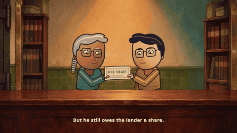
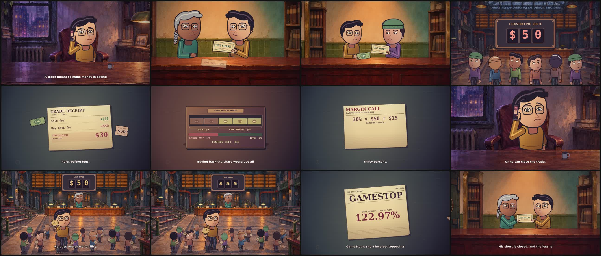
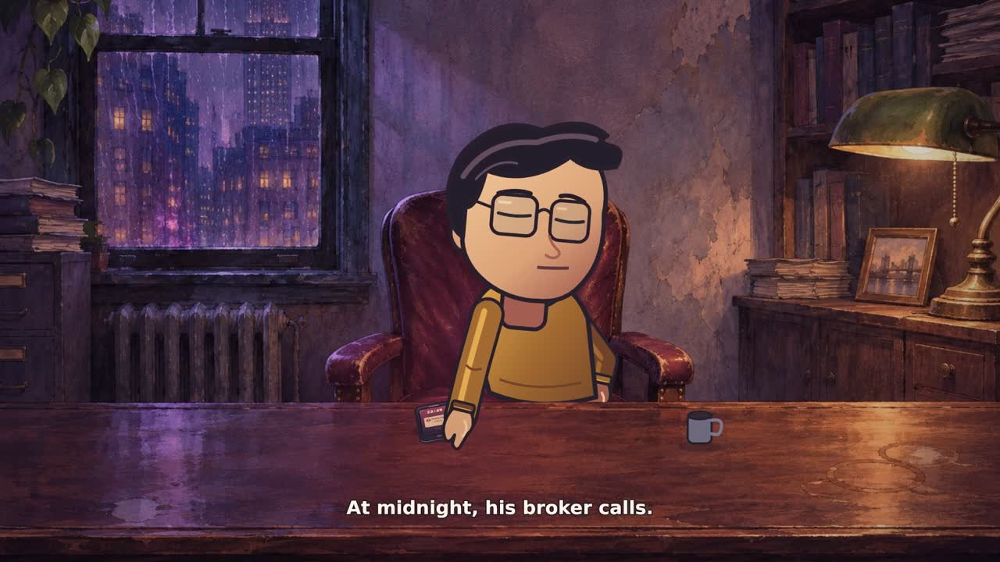
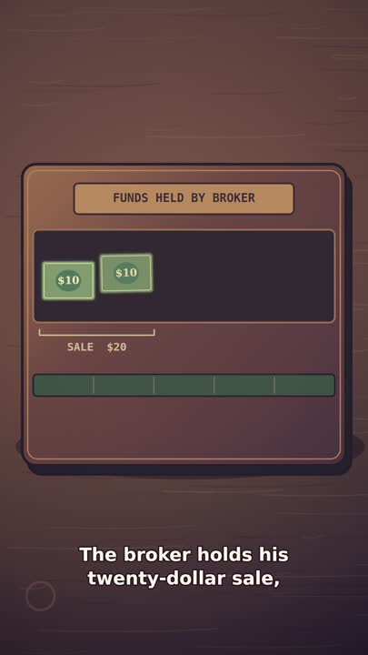

# Market Mechanics Studio

A local studio for animated finance shorts. The sample follows a fictional trader through a share loan, a margin call, and a crowded buyback auction. It uses painted sets, a poseable 2D cast, and staged props. The landscape and portrait cuts use their own framing.

- [The Anatomy of a Short Squeeze · 16:9](public/projects/short-squeeze-revised-wide/exports/narrated-captioned.mp4)
- [The Anatomy of a Short Squeeze · 9:16](public/projects/short-squeeze-revised-vertical/exports/narrated-captioned.mp4)



### Scene sheet

One frame from each of the 12 scenes in the 16:9 cut (`studio/squeeze-cut.json`).



| 16:9 | 9:16 |
| --- | --- |
|  |  |

## Open the studio

Run `./studio.sh serve` from the repository, then open http://127.0.0.1:4173. Use Node.js 22.13+ and `npm ci` to install dependencies on a fresh machine. The launcher can also use Codex Desktop's bundled Node. FFmpeg comes from `ffmpeg-static`. The older scene renderer uses Chrome and supports a `CHROME_PATH` override.

## Create a film with Codex or Claude Code

1. Open this repository as the agent's workspace. Give it your prompt, script, or scene overview, aspect ratio, and target runtime if you have one. **New video** in the dashboard can prepare the same brief.
2. The agent authors the shot animation and storyboard, then registers the episode. The dashboard refreshes its library automatically.
3. Open the project, play the film, or click a scene to jump to it. Toggle **Audio** and **Captions** independently. **Render MP4** saves the selected combination and adds a download link.

```sh
./studio.sh create studio/squeeze-cut.json --id my-squeeze --aspect 9:16
./studio.sh render my-squeeze
./studio.sh render my-squeeze --no-audio
./studio.sh render my-squeeze --no-captions
./studio.sh render my-squeeze --no-audio --no-captions
```

Captions burn into the selected MP4. Exports are cached under `public/projects/<id>/exports`. Audio changes can reuse the picture when the caption setting stays the same. To regenerate an existing export after editing shots, move both MP4s for that caption setting out of the exports folder. Use a new project ID when registering a new cut. To back up a film, keep its project directory, shot code, and set art together.

## Author shots

Start with [the short squeeze storyboard](studio/squeeze-cut.json). Each JSON file takes `title`, `aspect`, optional `summary`, optional `sources`, optional `duration` in seconds, optional `narrationTempo` (1 is normal playback speed), optional `score` (an audio file relative to the storyboard), and `scenes`. A film scene has `kind: "film"`, a registered `shot` ID, `label`, `headline`, `narration`, and optional `seconds`. The dashboard uses the label and headline to identify the shot.

Register shot functions and their set art in [the film registry](src/film/index.mjs). The renderer calls a shot with a Canvas 2D context, a viewport, its loaded set art, and the current shot progress. The viewport includes `clock` in seconds and a `portrait` flag. Use those inputs for pose changes, camera movement, and cuts. Put new set art under `public/films/<film-name>`. The sample demonstrates a shared [actor rig](src/film/performer.mjs), [props](src/film/props.mjs), and [camera helpers](src/film/paint.mjs). [Set art and prompts](studio/assets/README.md)

The studio computes scene starts. A fixed total duration scales the scene allocations to fit. When timing is omitted, the generated narration drives the runtime. The Remotion preview and the FFmpeg export use the same shot drawing code for the animated film. Earlier scene kinds (`candles`, `ledger`, `metric`, `loop`, `liquidity`, and `image`) remain readable by the studio.

The $20 sale, $30 cash deposit, $50 buyback, and $15 margin call are one simplified example before fees. The illustration uses a 30% maintenance cushion at $50. Actual margin requirements depend on the position and broker. [FINRA Rule 4210](https://www.finra.org/rules-guidance/rulebooks/finra-rules/4210) The historical insert uses the SEC staff report for GameStop's short interest and the role of broader buying. [SEC short interest data](https://www.sec.gov/files/staff-report-equity-options-market-struction-conditions-early-2021.pdf#page=22) · [SEC analysis of buying](https://www.sec.gov/files/staff-report-equity-options-market-struction-conditions-early-2021.pdf#page=27)

## Audio

Set `ELEVENLABS_API_KEY` and `ELEVENLABS_VOICE_ID` in `.env` to use ElevenLabs and its character timestamps. To use local neural speech, install `piper-tts` in Python, download a voice, and set `PIPER_MODEL` to its ONNX file. Set `PIPER_PYTHON` if Piper is in a virtual environment. Piper measures each sentence and estimates phrase starts within it. The sample uses Piper and an original score with Foley effects. [Piper CLI setup](https://github.com/OHF-Voice/piper1-gpl/blob/main/docs/CLI.md) · [Sample voice model](https://huggingface.co/rhasspy/piper-voices/tree/main/en/en_US/ryan/high)

With neither provider configured, Linux can use eSpeak NG (`libespeak-ng1` on Ubuntu) and Python 3. Pass `--voice none` to omit narration and estimate caption timings from the script. A storyboard with a score saves an audio mix plus the original voice track. The dashboard's audio switch controls the full mix.

## HyperFrames handoff

```sh
./studio.sh hyperframes short-squeeze-revised-wide
cd hyperframes/short-squeeze-revised-wide
npx hyperframes lint
npx hyperframes render
```

The handoff uses the clean picture track and represents audio and captions as separate HTML clips. Use `--no-audio` or `--no-captions` to omit a layer.
